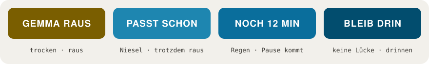

  

<h3 align="center">Wann kann ich in Salzburg rausgehen, ohne nass zu werden?</h3>

  Ein hyperlokales Regenradar für Salzburg. Es liest Regenmesser, Radar und Wettermodelle für deinen genauen Standort und gibt dir eine einzige Antwort.

  <a href="https://www.gemmaraus.at"><b>App öffnen: gemmaraus.at</b></a>
  &nbsp;·&nbsp; <a href="README.md">English</a>
  &nbsp;·&nbsp; <a href="docs/how-it-works.md">So funktioniert's (EN)</a>
  &nbsp;·&nbsp; <a href="docs/principles.md">Prinzipien (EN)</a>
  &nbsp;·&nbsp; <a href="docs/story.md">Die Geschichte (EN)</a>

  
  
  
  
  

---

## Eine Frage, eine Antwort

Die meisten Wetter-Apps sagen dir „60 % Regenwahrscheinlichkeit heute". Das ist eine Statistik, keine Entscheidung. Wenn du mit halb angezogenen Schuhen an der Tür stehst, willst du etwas Einfacheres wissen: **Kann ich jetzt los, und wie lange bleibt es trocken?**

Genau das beantwortet **Gemma Raus**, für die nächsten drei Stunden, an dem Fleck, an dem du gerade stehst. Du bekommst eine von vier Antworten:

  

| Antwort | Bedeutung |
|---|---|
| **GEMMA RAUS** | Es ist trocken, und es bleibt lange genug trocken, dass es sich auszahlt. |
| **PASST SCHON** | Leichter Niesel. Eine Jacke reicht, geh ruhig. |
| **NOCH 12 MIN** | Es regnet, aber eine echte Pause von mindestens 30 Minuten kommt. So lange warten. |
| **BLEIB DRIN** | Kein brauchbares Trockenfenster in Sicht. Bleib drin, die App sagt dir, wenn sich das ändert. |

Sobald Regen im Spiel ist, steht immer **genau ein Countdown** am Bildschirm („Regen in etwa 25 Min.", „trocken in 12 Min."). Er ist ehrlich gerundet, statt Genauigkeit vorzutäuschen, und zählt zwischen den Aktualisierungen direkt am Handy weiter.

## So schaut's aus

<table>
  <tr>
    <td align="center" width="33%"> Ein trockener Nachmittag</td>
    <td align="center" width="33%"> Dunkles Design (Englisch)</td>
    <td align="center" width="33%"> Die kommenden Tage, Stunde für Stunde</td>
  </tr>
</table>

## Was drin ist

- **Das Urteil.** Eine Schlagzeile, ein Satz, ein Countdown. Nichts zu deuten.
- **Das Regenband.** Die nächsten 12 Stunden in Kacheln. Volle Kacheln hat das Radar gemessen, gestrichelte schätzt ein Wettermodell. Die beiden werden nie gleich gezeichnet.
- **Eine Live-Radarkarte** von Salzburg und den Orten rundherum (Freilassing, Bad Reichenhall, Hallein, Seekirchen, Eugendorf und mehr). Jeder Ort bekommt seine eigene Antwort, und du kannst in die nächsten Stunden der Radarvorhersage vorspulen.
- **Die kommenden Tage.** Ein Fünf-Tage-Ausblick, der zeigt, *wann* ein Tag nass wird, nicht nur ob. Er hilft beim Planen, überstimmt aber nie die Antwort für jetzt.
- **Offizielle Warnungen** von GeoSphere Austria, dazu eine Gewitterwache für Tage, an denen die Luft über den Alpen labil wird.
- **Benachrichtigungen, wenn du willst:** wenn Regen gleich anfängt, ein Wolkenbruch kommt oder ein Trockenfenster aufgeht.
- **Für echte Handys gebaut:** Deutsch und Englisch, hell und dunkel, am Startbildschirm installierbar und auch auf älteren iPhones und Androids lauffähig.

## Warum Salzburg eine eigene Regen-App braucht

Salzburg ist berühmt für seinen *Schnürlregen*, der tagelang über der Stadt hängen kann. Im Sommer bauen sich Gewitter an den Alpen auf und können in 15 bis 20 Minuten von blauem Himmel zu Wolkenbruch werden.

Ein großes Wettermodell kommt da nicht mit. Es rechnet etwa stündlich und hinkt schnellen Alpengewittern oft stundenlang hinterher: Es hat schon „teilweise bewölkt, 0,0 mm" gemeldet, während es geschüttet hat. Und im Umkreis von 15 km um die Innenstadt gibt es nur **zwei** echte Regenmesser. Alles andere ist Radar oder Modell.

Keiner Quelle kann man also allein trauen. Genau darauf ist Gemma Raus gebaut.

## Wie die App entscheidet, kurz gesagt

Die App teilt die Frage in zwei Hälften und gibt jede dem Instrument, das sie am besten beantworten kann.

- **JETZT: Werde ich gerade nass?** Das ist Sache des **Bodens**: echte Regenmesser von GeoSphere Austria, dazu das aktuellste Radarbild der paar hundert Meter um dich herum. Das erwischt den Niesel, der zwischen den Messstationen fällt.
- **ALS NÄCHSTES: Wann fängt der Regen an, wann hört er auf?** Das ist Sache der **Radarvorhersage**: der 1-km-Nowcast von GeoSphere, in 15-Minuten-Schritten, drei Stunden voraus. Er sieht Schauer über den Bergen entstehen, die die großen Modelle erst Stunden später bemerken.
- **DAZWISCHEN: Die Geschichte bleibt stimmig.** Die App merkt sich, was sie dir zuletzt gesagt hat. Zweimal in einer Minute öffnen ergibt nie zwei verschiedene Geschichten. Und wenn sie einmal „bleib drin" gesagt hat, wartet sie, bis die Ruhe echt ist, bevor sie „raus" sagt.

Wenn sich die Instrumente widersprechen, entscheidet eine feste Reihenfolge von Regeln. Jede dieser Regeln gibt es, weil die App an einem echten Nachmittag danebenlag. [Mehr dazu (Englisch) →](docs/how-it-works.md)

## Woran wir glauben

- **Zu früh ist verziehen, zu spät nie.** Fünf Minuten zu früh gewarnt ist in Ordnung. Fünf Minuten zu spät ist ein Fehler.
- **Lieber bleibst du drin, als dass wir dich in den Regen schicken.**
- **Eine klare Antwort schlägt mehr Daten.** Sechs Quellen arbeiten im Hintergrund, damit du nur einen Satz lesen musst.
- **Der Countdown ist ein Versprechen.** Ein Countdown, stabil, ehrlich darüber, wie genau er sein kann.
- **Geändert wird nur, was eindeutig besser ist.** Jede Meldung wird zuerst mit Live-Wetterdaten geprüft, und jede Korrektur wird zu einem Test.

## Deine Privatsphäre

- **Kein Account, keine Cookies, keine Werbung, kein Tracking.**
- **Dein Standort erreicht nie unseren Server.** Der Server schickt die Vorhersage für die ganze Stadt, dein Handy sucht sich deinen Punkt heraus.
- Benachrichtigungen nur, wenn du sie einschaltest. Schriften und App-Dateien kommen von unserem eigenen Server.
- Kartenkacheln und Radarbilder werden von Esri und RainViewer geladen, die dabei deine IP-Adresse sehen, wie jede Seite, von der man ein Bild lädt. Die [Datenschutzerklärung](https://www.gemmaraus.at/privacy/) nennt alle, die irgendetwas sehen, und warum.

## So bekommst du sie

Öffne **[gemmaraus.at](https://www.gemmaraus.at)** im Browser deines Handys und erlaube den Standort. Fertig.

Für den Startbildschirm:

- **iPhone (Safari):** Teilen antippen, dann *Zum Home-Bildschirm*.
- **Android (Chrome):** Menü antippen, dann *App installieren*.

Abgedeckt sind die Stadt Salzburg und die Umgebung (rund 50 km). Weiter weg sagt dir die App das ehrlich, statt zu raten.

## Häufige Fragen

**Regnet es gleich in Salzburg?**
Öffne die App, und du siehst einen Live-Countdown bis zum nächsten Regen an deinem Standort, samt Warnung, wenn dein Trockenfenster gleich zugeht.

**Welches Regenradar ist das beste für Salzburg?**
Für die Stadt selbst brauchst du österreichische Daten in feiner Auflösung. Gemma Raus kombiniert den 1-km-Radar-Nowcast und die Messstationen von GeoSphere Austria mit dem Live-Radar von RainViewer und den Modellen von Open-Meteo, und macht daraus eine Antwort für deinen genauen Standort.

**Wie genau ist das?**
Alpenwetter ist schnell und sehr lokal, und keine Vorhersage ist eine Garantie. Ein Schauer, der nur ein, zwei Minuten dauert, kann unter jedem Instrument durchrutschen. Was die App verspricht: Sie gibt nie Entwarnung, wenn eine ihrer eigenen Quellen widerspricht, und sie sagt es offen, wenn sie unsicher ist.

**Ist Gemma Raus kostenlos?**
Ja. Kein Account, kein Abo, keine Werbung.

**Funktioniert es auch außerhalb von Salzburg?**
Die Daten sind auf Salzburg und Umgebung abgestimmt. Weiter als etwa 50 km weg zeigt dir die App lieber Salzburg, statt über deinen Standort zu raten.

**Gibt es die App im App Store?**
Gemma Raus ist eine Web-App, die du direkt aus dem Browser installierst. Sie funktioniert wie eine normale App, nur ohne Store.

Mehr dazu: [Regenradar Salzburg](https://www.gemmaraus.at/regenradar-salzburg/) · [Wetter Salzburg](https://www.gemmaraus.at/wetter-salzburg/) · [Regnet es heute in Salzburg?](https://www.gemmaraus.at/regen-salzburg-heute/)

## Gebaut auf offenen Daten

Gemma Raus steht auf den Schultern öffentlicher Wetterdienste:

- [**GeoSphere Austria**](https://www.geosphere.at): Radar-Nowcast, TAWES-Messstationen, das AROME-Modell und offizielle Warnungen (CC BY 4.0)
- [**Open-Meteo**](https://open-meteo.com): ICON-EU-Vorhersagen und der Tagesausblick (CC BY 4.0)
- [**RainViewer**](https://www.rainviewer.com): Live-Radarbilder
- [**OpenStreetMap**](https://www.openstreetmap.org)-Mitwirkende und **Esri**: die Grundkarte

## Über das Projekt

Gemma Raus wird in Salzburg von **Bestin Antu** entworfen und gebaut.
Fragen, Ideen oder eine Vorhersage, die dich nass gemacht hat: **contact@gemmaraus.at**

Dieses Repository ist das öffentliche Zuhause der Projektdokumentation. Der Quellcode der App ist nicht veröffentlicht. Die Dokumentation hier steht unter der [MIT-Lizenz](LICENSE); der Name *Gemma Raus* und das Logo nicht.
