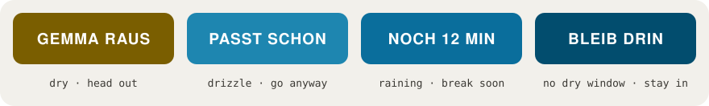
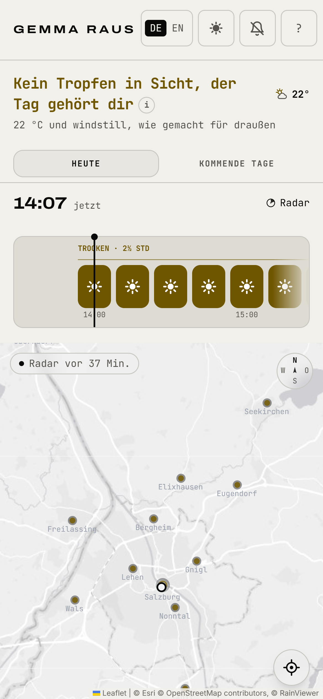
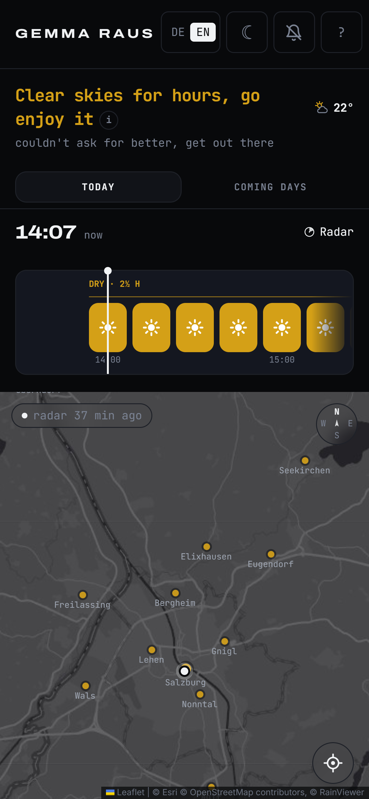
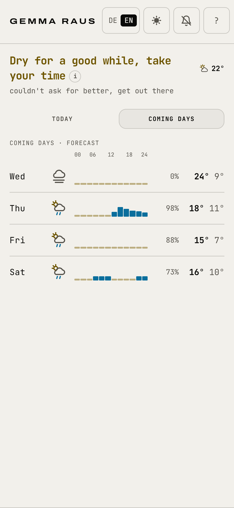
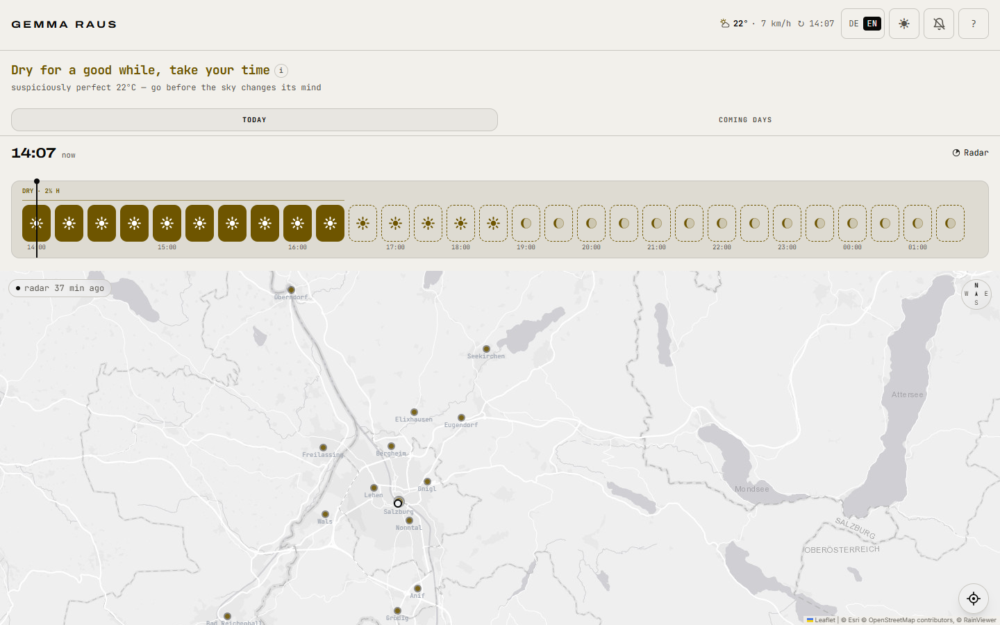

  

<h3 align="center">When can I go outside in Salzburg without getting wet?</h3>

  A hyper-local rain radar for Salzburg, Austria. It reads the rain gauges, the radar and the weather models for your exact spot, and gives you one answer.

  <a href="https://www.gemmaraus.at"><b>Open the app at gemmaraus.at</b></a>
  &nbsp;·&nbsp; <a href="README.de.md">Deutsch</a>
  &nbsp;·&nbsp; <a href="docs/how-it-works.md">How it works</a>
  &nbsp;·&nbsp; <a href="docs/principles.md">Principles</a>
  &nbsp;·&nbsp; <a href="docs/story.md">The story</a>

  
  
  
  
  

---

## One question, one answer

Most weather apps tell you there is a "60 % chance of rain today". That is a statistic, not a decision. When you are standing at the door with your shoes half on, you want to know something simpler: **can I go now, and for how long?**

**Gemma Raus** (Austrian dialect for *"let's go outside!"*) answers exactly that, for the next three hours, at the spot where you are standing. You get one of four answers:

  

| Answer | Meaning |
|---|---|
| **GEMMA RAUS** | It's dry, and it stays dry long enough to be worth going. |
| **PASST SCHON** | Light drizzle. A jacket is enough, go anyway. |
| **NOCH 12 MIN** | It's raining, and a real break of at least 30 minutes is coming. Wait this long. |
| **BLEIB DRIN** | No usable dry window in sight. Stay in, and the app tells you when that changes. |

Whenever rain is involved, there is always **exactly one countdown** on screen ("rain in about 25 min", "dry in 12 min"). It's rounded honestly instead of pretending to be precise, and it ticks down on your phone between updates.

## See it

<table>
  <tr>
    <td align="center" width="33%"> A dry afternoon, in German</td>
    <td align="center" width="33%"> Dark theme, in English</td>
    <td align="center" width="33%"> The coming days, hour by hour</td>
  </tr>
</table>

   
  On a big screen, the whole 12-hour ribbon fits in one row. Point at any time to read it.

## What's inside

- **The verdict.** One headline, one sentence, one countdown. Nothing to interpret.
- **The rain ribbon.** The next 12 hours in tiles. Solid tiles are measured by radar; dashed tiles are a model's estimate. The two are never drawn the same way.
- **A live radar map** of Salzburg and the towns around it (Freilassing, Bad Reichenhall, Hallein, Seekirchen, Eugendorf and more). Each town gets its own answer, and you can scrub forward into the coming hours of the radar forecast.
- **The coming days.** A five-day outlook that shows *when* each day gets wet, not just whether. It helps you plan; it never overrides the answer for right now.
- **Official warnings** from GeoSphere Austria, plus a thunderstorm watch for days when the Alpine air turns unstable.
- **Optional notifications** when rain is about to start, a downpour is coming, or a dry window opens.
- **Made for real phones:** German and English, light and dark, installable on the home screen, and built to work on older iPhones and Androids too.

## Why Salzburg needs its own rain app

Salzburg is famous for its *Schnürlregen*, the steady rain that can sit over the city for days. In summer, storms build up against the Alps and can go from clear sky to downpour in 15 to 20 minutes.

A national forecast model can't keep up with that. It runs every hour or so, and on fast Alpine storms it can be hours late: it has reported "partly cloudy, 0.0 mm" during heavy rain. And there are only **two** real rain gauges within 15 km of the city centre. Everything else is radar or a model.

So no single source can be trusted on its own. Gemma Raus is built around that fact.

## How it decides, in short

The app splits the question in two and gives each half to the instrument that is best at it.

- **NOW: am I getting wet right now?** This is the job of the **ground**: real rain gauges from GeoSphere Austria, plus the latest radar picture of the few hundred metres around you, which catches the drizzle that falls between the gauges.
- **NEXT: when does rain start or stop?** This is the job of the **radar forecast**: GeoSphere's 1 km nowcast, in 15-minute steps, three hours ahead. It sees showers forming over the mountains that the big weather models won't notice for hours.
- **IN BETWEEN: keep the story straight.** The app remembers what it last told you, so opening it twice in a minute never gives you two different stories. Once it has told you to stay in, it waits until the calm is real before saying "go".

When the instruments disagree, a fixed order of rules decides, and every rule exists because of a real afternoon when the app got it wrong. [Read how it works →](docs/how-it-works.md)

## What we believe

- **Leads are forgiven, lags never.** Warning you five minutes early is fine. Warning you five minutes late is a failure.
- **Better you stay in than get sent into the rain.**
- **One clear answer beats more data.** Six sources run behind the scenes so that you only have to read one sentence.
- **The countdown is a promise.** One countdown, stable, honest about how precise it can be.
- **Change only what is clearly better.** Every report is checked against live weather data before anything changes, and every fix becomes a test.

[The full principles →](docs/principles.md)

## Your privacy

- **No account, no cookies, no ads, no tracking.**
- **Your location never reaches our server.** The server sends the forecast for the whole city, and your phone picks out your spot.
- Notifications are opt-in. Fonts and app files come from our own server.
- The map tiles and radar images are loaded from Esri and RainViewer, which see your IP address like any site you load an image from. The [privacy policy](https://www.gemmaraus.at/privacy/en/) names everyone who sees anything, and why.

## Get it

Open **[gemmaraus.at](https://www.gemmaraus.at)** in your phone's browser and allow your location. That's it.

To keep it on your home screen:

- **iPhone (Safari):** tap Share, then *Add to Home Screen*.
- **Android (Chrome):** tap the menu, then *Install app*.

It covers Salzburg city and the area around it (about 50 km). Further away, the app tells you so instead of guessing.

## FAQ

**Is it going to rain in Salzburg soon?**
Open the app and you'll see a live countdown to the next rain at your location, plus a warning when your dry window is about to close.

**What is the best rain radar for Salzburg?**
For the city itself, you want Austrian data at a fine scale. Gemma Raus combines GeoSphere Austria's 1 km radar nowcast and rain gauges with live RainViewer radar and the Open-Meteo models, and turns them into one answer for your exact spot.

**How accurate is it?**
Alpine weather is fast and very local, and no forecast is a guarantee. A shower that lasts one or two minutes can slip under every instrument. What the app does promise is never to claim an all-clear that one of its own sources contradicts, and to say so plainly when it isn't sure.

**Is it free?**
Yes. No account, no subscription, no ads.

**Does it work outside Salzburg?**
The data is tuned for Salzburg and its surroundings. Beyond about 50 km, the app offers to show Salzburg instead of guessing about your location.

**Is there an app in the App Store?**
Gemma Raus is a web app you install straight from the browser. It works like a regular app, without a store.

More in German: [Regenradar Salzburg](https://www.gemmaraus.at/regenradar-salzburg/) · [Wetter Salzburg](https://www.gemmaraus.at/wetter-salzburg/) · [Regnet es heute in Salzburg?](https://www.gemmaraus.at/regen-salzburg-heute/)

## Built on open data

Gemma Raus stands on the shoulders of public weather services:

- [**GeoSphere Austria**](https://www.geosphere.at): radar nowcast, TAWES ground stations, the AROME model and official warnings (CC BY 4.0)
- [**Open-Meteo**](https://open-meteo.com): ICON-EU forecasts and the daily outlook (CC BY 4.0)
- [**RainViewer**](https://www.rainviewer.com): live radar images
- [**OpenStreetMap**](https://www.openstreetmap.org) contributors and **Esri**: the base map

## About

Gemma Raus is designed and built in Salzburg by **Bestin Antu**.
Questions, ideas, or a forecast that got you wet: **contact@gemmaraus.at**

This repository is the public home of the project's documentation. The app's source code is not published. The documentation here is under the [MIT License](LICENSE); the name *Gemma Raus* and its logo are not.
